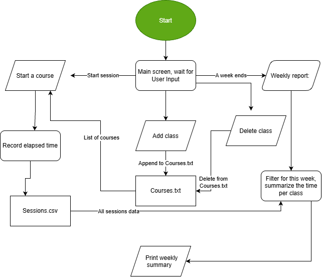

# Study Tracker

A study tracker that tracks your study time and writes weekly reports.

## The Problem

I try to be balanced when studying for different courses, but sometimes I neglect a subject or spend too much time studying one subject. I need to the study time properly.

## How It Works

Study Tracker is a command-line program. You add your courses once, then start a timer when start studying and stop it when you're done. At the end of the week, it prints a report showing how much time went to each course.



## Tech Stack

- **Language:** Java
- **Libraries:** built-in libraries
- **External tools:** JUnit

## Setup

```bash
git clone https://github.com/olivia-s-park/studytracker
cd studytracker
javac -d out src/*.java
```

## Usage

Add and remove courses:
```bash
java -cp out StudyTracker add CS180
java -cp out StudyTracker remove MA261 
```
Time a study session:
```bash
java -cp out StudyTracker start CS180
java -cp out StudyTracker stop
```

## Roadmap

Features I haven't built yet but plan to.

- [ ] Streaks
- [ ] Goals
- [ ] Week-over-week comparison
- [ ] Manual hour logging 

## Author

Olivia park, https://github.com/olivia-s-park